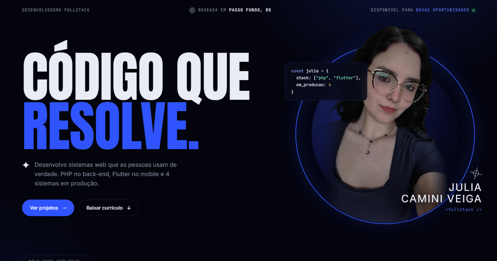

# byjuliacamini.com.br

Meu portfólio pessoal: **Julia Camini Veiga**, desenvolvedora fullstack (PHP · Flutter).

🔗 **[byjuliacamini.com.br](https://byjuliacamini.com.br)**



## Sobre o projeto

Site de uma página só, feito do zero com **HTML, CSS e JavaScript puros**, sem frameworks. Apresenta os sistemas que desenvolvi e mantenho em produção, minha experiência, formação, habilidades e contato.

### Destaques

- Layout responsivo (desktop, tablet e celular), com menu próprio no mobile
- Tema escuro com cor de destaque definida em variáveis CSS, fácil de trocar
- Animações de entrada ao rolar a página com `IntersectionObserver`, respeitando `prefers-reduced-motion`
- Contadores animados nos números de destaque
- Foto com fundo removido que "sai" do círculo, usando `mask-image`
- Imagens em WebP para carregar rápido
- Meta tags Open Graph para a prévia do link em redes sociais

## Estrutura

```
├── index.html          # página única
├── css/style.css       # estilos e tema (cores no topo do arquivo)
├── js/main.js          # menu mobile, animações e contadores
└── assets/
    ├── foto.webp
    ├── curriculo.pdf
    ├── og.png          # imagem de compartilhamento
    └── projetos/       # prints dos sistemas
```

## Rodando localmente

Não precisa instalar nada: basta abrir o `index.html` no navegador.

## Contato

[LinkedIn](https://www.linkedin.com/in/juliacaminiveiga) · [GitHub](https://github.com/Caminiju) · juliacamini09@gmail.com
